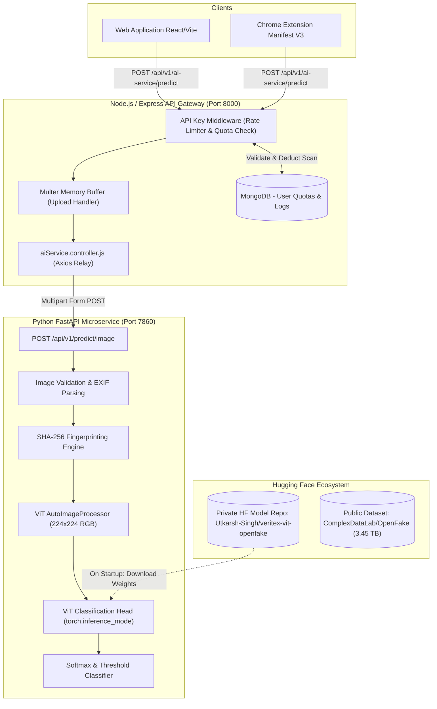
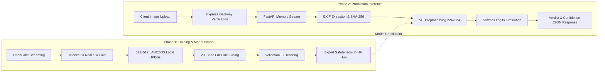
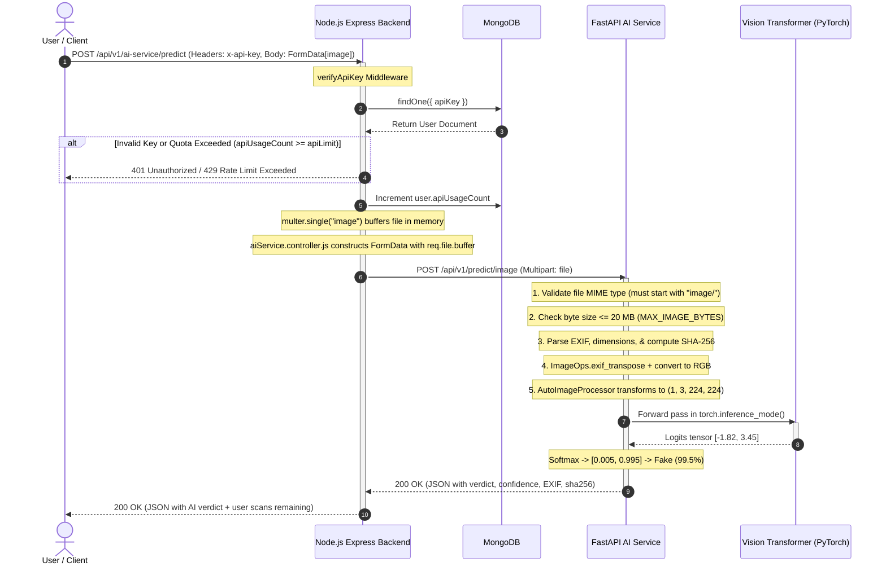

# 🧠 VeriTex AI Service — Deepfake Image Detection Engine

VeriTex is the core AI microservice powering the **Veritas** deepfake detection platform. It implements a fine-tuned **Vision Transformer (ViT)** capable of distinguishing authentic photographs from AI-generated or manipulated images (generated by diffusion models, GANs, etc.).

This service covers the complete machine learning lifecycle:
1. **Training & Evaluation Pipeline** (`training/`): Streaming the massive OpenFake dataset, data balancing, hardware-agnostic acceleration (CUDA/TPU/CPU), full fine-tuning of `google/vit-base-patch16-224-in21k`, and private Hugging Face Hub publishing.
2. **Production Inference Service** (`main.py`): A high-performance, containerized **FastAPI** REST microservice providing single-image deepfake classification, confidence scoring, EXIF forensic inspection, and SHA-256 fingerprinting.

---

## 📑 Table of Contents

- [System Architecture](#-system-architecture)
- [Complete Data Flow Lifecycle](#-complete-data-flow-lifecycle)
- [Phase 1: Training & Evaluation Pipeline](#-phase-1-training--evaluation-pipeline)
  - [1. Data Ingestion & Balancing (`data.py`)](#1-data-ingestion--balancing-datapy)
  - [2. Hardware Abstraction Layer (`runtime.py`)](#2-hardware-abstraction-layer-runtimepy)
  - [3. Full Model Fine-Tuning (`train.py`)](#3-full-model-fine-tuning-trainpy)
  - [4. Out-of-Distribution Evaluation (`evaluate.py`)](#4-out-of-distribution-evaluation-evaluatepy)
- [Phase 2: Production Prediction Pipeline](#-phase-2-production-prediction-pipeline)
  - [Step-by-Step Flow: Backend to AI Service](#step-by-step-flow-backend-to-ai-service)
  - [Sequence Diagram](#sequence-diagram)
  - [Forensic & Vision Processing Breakdown](#forensic--vision-processing-breakdown)
- [Data Models & Schema Specifications](#-data-models--schema-specifications)
  - [Tensor Shapes & Transformations](#tensor-shapes--transformations)
  - [FastAPI Input & Output Contracts](#fastapi-input--output-contracts)
  - [Backend Relay & Database Integration](#backend-relay--database-integration)
- [Deep Dive: Critical Code Walkthrough](#-deep-dive-critical-code-walkthrough)
- [Deployment & Setup Guide](#-deployment--setup-guide)
  - [Local Development](#local-development)
  - [Docker Deployment](#docker-deployment)
  - [Hugging Face Spaces Deployment](#hugging-face-spaces-deployment)
- [Environment Configuration](#-environment-configuration)

---

## 🏛️ System Architecture

The following diagram illustrates how the AI service integrates with the broader Veritas ecosystem:



---

## 🔄 Complete Data Flow Lifecycle



---

## 🏋️ Phase 1: Training & Evaluation Pipeline

The training pipeline fine-tunes a pretrained **Vision Transformer** (`google/vit-base-patch16-224-in21k`) into a binary deepfake classifier.

### 1. Data Ingestion & Balancing (`data.py`)
- **Dataset**: `ComplexDataLab/OpenFake` (over 3.45 TB of authentic images and deepfakes from advanced generative models like Midjourney, Stable Diffusion, DALL-E, etc.).
- **Streaming Mode**: To eliminate the requirement of downloading multi-terabyte archives, `load_dataset(..., streaming=True)` lazily streams items.
- **Deterministic Balanced Sampling**: `collect_balanced_split` gathers exactly `N` images per class (`real: 0`, `fake: 1`), resizes them to 512×512 using high-quality `LANCZOS` resampling, and caches them locally to avoid repeated network round-trips.
- **Interruption Resilience**: File naming format `{count:06d}_{stream_index:09d}.jpg` tracks the stream index, allowing the downloader to seamlessly resume interrupted downloads.

### 2. Hardware Abstraction Layer (`runtime.py`)
`resolve_device(preference)` dynamically detects the available accelerator without code modification:
1. **CUDA GPUs** (NVIDIA T4, V100, A100): Uses native CUDA with mixed precision (`bfloat16` or `float16` via `torch.amp.GradScaler`).
2. **Native Google Colab TPUs** (v5e-1): Dynamically detects and registers `torch_tpu`.
3. **Legacy PyTorch/XLA TPUs**: Fallback to `torch_xla.core.xla_model`.
4. **CPU**: Available for local debugging with `--allow-cpu`.

### 3. Full Model Fine-Tuning (`train.py`)
- **Architecture**: `AutoModelForImageClassification` with binary classification heads (`id2label = {0: "real", 1: "fake"}`). All 86M+ parameters are fine-tuned (full fine-tuning, not just head tuning).
- **Memory Optimization**:
  - **Gradient Checkpointing** (`model.gradient_checkpointing_enable()`): Reduces peak VRAM consumption by recomputing activations during the backward pass.
  - **Mixed Precision (AMP)**: Leverages `bfloat16` on supported hardware to halve memory bandwidth and double compute throughput.
  - **Gradient Accumulation**: Enables effective batch sizes of 16–32 on memory-constrained GPUs (such as free-tier Google Colab T4s).
- **Data Augmentation**: `LocalImages` dataset applies `ImageOps.exif_transpose` and random horizontal flipping (50% probability) during training.
- **Optimization Strategy**: `AdamW` optimizer with learning rate `2e-5`, weight decay `0.01`, and gradient clipping norm `1.0`.
- **Model Checkpointing**: Evaluates after each epoch on held-out validation data. Checkpoints (`model.safetensors`, `config.json`, `preprocessor_config.json`) are only updated when validation `f1_fake` improves.
- **Hugging Face Hub Integration**: Optional `--push-to-hub` flag automatically uploads model artifacts to a private Hugging Face repository.

### 4. Out-of-Distribution Evaluation (`evaluate.py`)
Evaluates the fine-tuned model against held-out benchmark distributions:
- `core/test`: Measures generalization against unseen generative architectures and domain shifts.
- `reddit/test`: Evaluates real-world in-the-wild user uploads containing social media compression artifacts.
- Metrics output: **Accuracy**, **Precision (Fake)**, **Recall (Fake)**, **F1-Score (Fake)**, **ROC-AUC**, and a 2×2 **Confusion Matrix**.

---

## ⚡ Phase 2: Production Prediction Pipeline

### Step-by-Step Flow: Backend to AI Service

When an end-user scans an image from the Web App or Chrome Extension, the request traverses the entire stack:



### Forensic & Vision Processing Breakdown

In `main.py`, incoming images undergo forensic and neural inspection:

```
Raw Uploaded Bytes
       │
       ├─► 1. Byte Counter ────────► Enforces MAX_IMAGE_BYTES (20MB) limit
       │
       ├─► 2. SHA-256 Engine ──────► Computes unique cryptographic hash
       │
       ├─► 3. PIL EXIF Parser ─────► Extracts Make/Model (tag 272) & Software (tag 305)
       │
       ├─► 4. EXIF Orientation ────► Corrects image orientation via exif_transpose
       │
       ├─► 5. AutoImageProcessor ──► Resizes to 224×224, scales to [0, 1], normalizes (ImageNet stats)
       │
       └─► 6. ViT Forward Pass ────► Transformer blocks compute spatial attention
                                            │
                                            ▼
                                  Logits ──► Softmax ──► Verdict & Confidence
```

---

## 📊 Data Models & Schema Specifications

### Tensor Shapes & Transformations

| Stage | Data Representation | Shape / Dimensions | Description |
| :--- | :--- | :--- | :--- |
| **Input File** | Binary byte stream | Variable (up to 20 MB) | Raw payload from HTTP multipart stream. |
| **PIL Image** | RGB Pillow object | `(Width, Height, 3)` | Rotated to normal orientation, converted to 8-bit RGB. |
| **ViT Processor** | PyTorch Float Tensor | `(1, 3, 224, 224)` | Scaled `[0, 1]`, normalized with mean `[0.5, 0.5, 0.5]` and std `[0.5, 0.5, 0.5]`. |
| **Model Logits** | Unnormalized log-odds | `(1, 2)` | Class 0: `real`, Class 1: `fake`. |
| **Softmax Probs**| Probability distribution | `(1, 2)` | Normalized values summing to 1.0. |

### FastAPI Input & Output Contracts

#### Endpoint: `POST /api/v1/predict/image`
- **Content-Type**: `multipart/form-data`
- **Fields**: `file` (or `image`): Image binary (`image/jpeg`, `image/png`, `image/webp`).

#### Success Response (`200 OK`):
```json
{
  "status": "success",
  "verdict": "fake",
  "confidence": 98.74,
  "data": {
    "verdict": "fake",
    "confidence": 98.74,
    "class_scores": {
      "real": 1.26,
      "fake": 98.74
    },
    "image_info": {
      "width": 1024,
      "height": 1024,
      "format": "JPEG",
      "has_exif": true,
      "camera_model": null,
      "software": "Midjourney v6.0",
      "sha256": "e3b0c44298fc1c149afbf4c8996fb92427ae41e4649b934ca495991b7852b855"
    },
    "notice": "Model output is a prediction, not proof of authenticity. EXIF metadata can be removed or edited."
  }
}
```

#### Error Responses:
- `400 Bad Request`: File missing, invalid MIME type, or unidentifiable image bytes.
- `413 Payload Too Large`: Image exceeds configured upload limit (`MAX_IMAGE_BYTES`, default 20 MB).
- `500 Internal Server Error`: Model weights failed to load or runtime failure.

### Backend Relay & Database Integration

When Express proxies the result back to the frontend, it enriches the payload with user quota data:

```json
{
  "status": "success",
  "message": "Image scanned successfully",
  "data": {
    "status": "success",
    "verdict": "fake",
    "confidence": 98.74,
    "data": { ... }
  },
  "apiUsageCount": 14,
  "scansRemaining": 86
}
```

---

## 🔍 Deep Dive: Critical Code Walkthrough

### 1. Model Lifecycle Management (`main.py`)
```python
@asynccontextmanager
async def lifespan(app: FastAPI):
    # Executed once on FastAPI cold-start
    app.state.processor = AutoImageProcessor.from_pretrained(
        MODEL_ID, token=HF_TOKEN, use_fast=True
    )
    app.state.model = AutoModelForImageClassification.from_pretrained(
        MODEL_ID, token=HF_TOKEN
    ).to(DEVICE)
    app.state.model.eval()
    yield
    # Executed during shutdown: cleans up GPU VRAM
    del app.state.model
    del app.state.processor
```
* **Why this matters**: Neural network weights (~340 MB) are loaded into memory and GPU VRAM only once during server initialization. Subsequent prediction requests reuse the cached in-memory model, yielding sub-100ms inference times.

### 2. EXIF Forensic Extraction & Transposition (`main.py`)
```python
with Image.open(io.BytesIO(image_bytes)) as source:
    image_info = {
        "width": source.width,
        "height": source.height,
        "format": (source.format or "unknown").upper(),
        "has_exif": bool(source.getexif()),
        "camera_model": str(source.getexif().get(272, ""))[:100] or None,
        "software": str(source.getexif().get(305, ""))[:100] or None,
    }
    image_obj = ImageOps.exif_transpose(source).convert("RGB")
```
* **EXIF Tag 272**: Camera model name.
* **EXIF Tag 305**: Software used to create or edit the image (often reveals generative AI tools or Photoshop).
* **`ImageOps.exif_transpose`**: Corrects image rotation according to camera orientation tags before feeding to the neural network.

### 3. Inference & Class Mapping (`main.py`)
```python
inputs = app.state.processor(images=image_obj, return_tensors="pt")
inputs = {name: tensor.to(DEVICE) for name, tensor in inputs.items()}
with torch.inference_mode():
    logits = app.state.model(**inputs).logits[0]
    probabilities = torch.softmax(logits, dim=-1)

class_id = int(probabilities.argmax().item())
raw_label = str(app.state.model.config.id2label.get(class_id, "")).strip().lower()
if raw_label not in {"real", "fake"}:
    raw_label = "fake" if class_id == 1 else "real"
```
* **`torch.inference_mode()`**: More efficient than `torch.no_grad()`, disabling tracking and view-tracking for faster inference.
* **Fallback Class Mapping**: Enforces binary stability (`0 -> real`, `1 -> fake`) regardless of upstream Hugging Face metadata differences.

### 4. Data Ingestion & Resumable Downloads (`training/data.py`)
```python
# Replaying a Hugging Face stream starts at its beginning. Skip rows
# through the last saved index so an interrupted download can resume.
if index <= last_saved_index:
    continue
```
* Streaming datasets on Hugging Face do not support random seeking. This index extraction strategy enables downloading large subsets without restarting from sample 0 if connection drops.

### 5. Gradient Checkpointing & Mixed Precision (`training/train.py`)
```python
model.gradient_checkpointing_enable()
...
with amp_context:
    loss = model(pixel_values=pixel_values, labels=labels).loss / accumulation
if scaler is not None:
    scaler.scale(loss).backward()
```
* Minimizes memory footprints by recomputing forward activations during backward propagation, enabling fine-tuning ViT-Base models on GPUs with 16 GB VRAM or Colab free-tier runtimes.

---

## 🚀 Deployment & Setup Guide

### Local Development

1. **Prerequisites**: Python 3.10+ installed.
2. **Setup Virtual Environment**:
   ```bash
   cd ai-service
   python -m venv deepfake_env
   # Windows:
   deepfake_env\Scripts\activate
   # Linux/macOS:
   source deepfake_env/bin/activate
   ```
3. **Install Inference Dependencies**:
   ```bash
   pip install -r requirements.txt
   ```
4. **Configure Environment Variables**:
   Create `ai-service/.env`:
   ```ini
   HF_TOKEN=your_huggingface_read_token
   HF_MODEL_ID=Utkarsh-Singh/veritex-vit-openfake
   MAX_IMAGE_BYTES=20971520
   ```
5. **Start Uvicorn Server**:
   ```bash
   uvicorn main:app --host 0.0.0.0 --port 7860 --reload
   ```
6. **Verify Health**:
   ```bash
   curl http://localhost:7860/health
   ```

---

### Docker Deployment

The `Dockerfile` is optimized for container platforms (such as Hugging Face Spaces, Render, or AWS ECS):

```bash
cd ai-service
docker build -t veritex-ai-service .
docker run -p 7860:7860 -e HF_TOKEN="your_hf_token" veritex-ai-service
```

---

### Hugging Face Spaces Deployment

This repository is pre-configured for **Hugging Face Spaces** (Docker or FastAPI SDK):
1. Create a new Space on Hugging Face with **Docker** SDK.
2. Under **Settings → Variables and Secrets**, define:
   - `HF_TOKEN`: Read token granting access to your model repo.
   - `HF_MODEL_ID`: e.g., `Utkarsh-Singh/veritex-vit-openfake`.
3. Push `ai-service/` contents to the Space repository.

---

## ⚙️ Environment Configuration

| Variable | Type | Default | Description |
| :--- | :--- | :--- | :--- |
| `HF_TOKEN` | String | *(Required for private repos)* | Hugging Face Access Token with read permissions. |
| `HF_MODEL_ID` | String | `Utkarsh-Singh/veritex-vit-openfake` | Model repo identifier on Hugging Face Hub. |
| `MAX_IMAGE_BYTES` | Integer | `20971520` (20 MB) | Maximum permitted image payload size in bytes. |
| `PORT` | Integer | `7860` | HTTP listening port for Uvicorn. |
